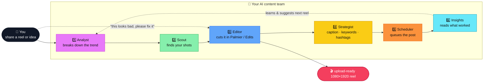
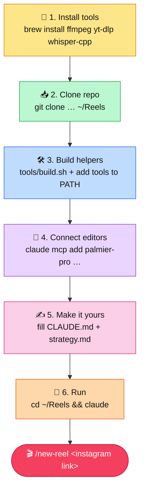
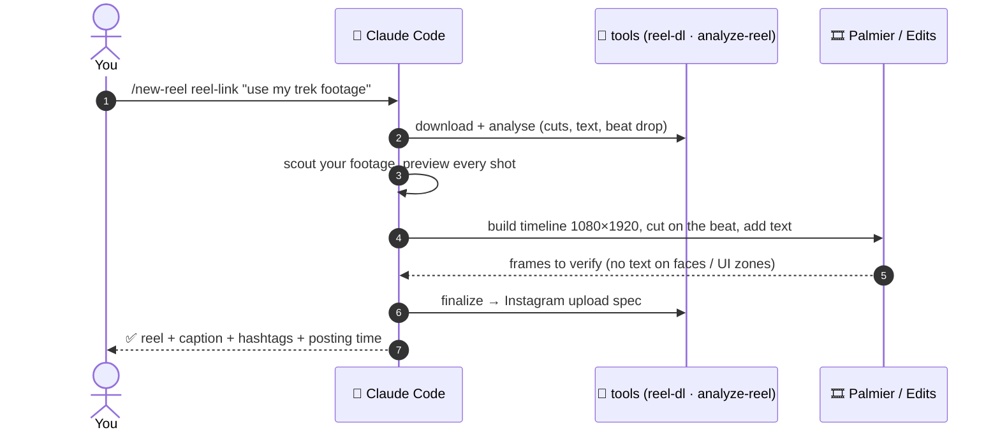

# Reel Agents 🤖🎬

**6 AI agents that run an Instagram reels account, built on [Claude Code](https://claude.com/claude-code).**

<p align="center">
  
  
  
  
  
</p>

## 🧭 How it works




You share a trending reel or an idea. The agents study it, find the right shots in your own
footage, edit the reel in a real video editor, write the caption and hashtags, help you
schedule it, and read your insights to tell you what to make next. You just say "this looks
bad, please fix it."

| # | Agent | What it does | Lives in |
|---|---|---|---|
| 1 | **Analyst** (`reference-analyst`) | Downloads trending reels, breaks down cuts, on-screen text, speech and the audio drop, and grows a knowledge base of what works | `.claude/agents/reference-analyst.md` |
| 2 | **Scout** (`footage-scout`) | Searches your folders and Apple Photos (scene labels, GPS, face tags) and returns a previewed shortlist with in/out points | `.claude/agents/footage-scout.md` |
| 3 | **Editor** (`reel-editor`) | Builds the reel in **Palmier Pro** and/or **Instagram Edits** over MCP: beat cuts, text, grade, export | `.claude/agents/reel-editor.md` + skill `instagram-reel` |
| 4 | **Strategist** (`reel-strategist`) | Ideas, hooks, captions, keywords, max 5 hashtags, trial vs profile, posting time | `.claude/agents/reel-strategist.md` + skill `reel-ideas` |
| 5 | **Scheduler** | Schedules reels in the Instagram app running in an Android emulator (optional, see below) | `tools/ig-avd/` |
| 6 | **Insights reader** | Reads your reel insights and logs results so the next ideas get better | `/log-results` + `CONTENT_LOG.md` |

There's also an optional **Telegram bot**: share a reel to it from your phone, and your Mac
builds versions and sends the files back (`tools/reel-bot/`).

> Everything runs on **your Mac, with your footage and your accounts**. Nothing is uploaded
> anywhere except the Claude API calls Claude Code makes, and the reels you post yourself.

---

## 📦 Requirements

| Need | Why | Install |
|---|---|---|
| **macOS** (Apple Silicon recommended) | Vision OCR, Apple Photos search, the editor apps | — |
| **Claude Code** | Runs the agents | `npm i -g @anthropic-ai/claude-code` or see [docs](https://docs.claude.com/en/docs/claude-code) |
| **Homebrew** | Installs the CLI tools | [brew.sh](https://brew.sh) |
| **ffmpeg** | Cutting, contact sheets, final export | `brew install ffmpeg` |
| **yt-dlp** | Downloading reference reels | `brew install yt-dlp` |
| **whisper.cpp** + model | Transcribing speech in reels | `brew install whisper-cpp` then download the model (below) |
| **Python 3** + Pillow, numpy | Contact sheets, analysis scripts | `pip3 install pillow numpy` |
| **Xcode Command Line Tools** | Building the OCR helper | `xcode-select --install` |
| **Palmier Pro** (Mac app) | The main video editor the agents drive | Install from its site; it exposes an MCP server while open |
| **Instagram Edits** (Mac app), *optional* | Instagram-native fonts, captions, filters, licensed music | Only if you have an MCP bridge for it (`metapilot-native`); otherwise skip, Palmier does everything else |
| **Android Studio emulator**, *optional* | Scheduler agent (drives the Instagram Android app) | Android Studio → Device Manager → create a Pixel AVD with Play Store |
| **Telegram bot token**, *optional* | The phone bot | Talk to [@BotFather](https://t.me/BotFather) |

Whisper model:
```bash
mkdir -p ~/.cache/whisper
curl -L -o ~/.cache/whisper/ggml-small.en.bin \
  https://huggingface.co/ggerganov/whisper.cpp/resolve/main/ggml-small.en.bin
```

---

## ⚡ Setup at a glance



## 🛠️ Setup (about 15 minutes)

### 1️⃣ Clone it as your workspace
This folder **is** your reels workspace. Your projects, references and footage folders live
next to the agent files (git ignores all media, so nothing personal gets committed).

```bash
git clone <this repo> ~/Reels
cd ~/Reels
```

### 2️⃣ Build the helpers and put the tools on your PATH
```bash
tools/build.sh                                   # builds tools/ocr and tools/fgmask
echo 'export PATH="$HOME/Reels/tools:$PATH"' >> ~/.zshrc && source ~/.zshrc
reel-dl --help 2>/dev/null; which analyze-reel finalize
```

### 3️⃣ Connect the editors (MCP)
Open **Palmier Pro**, then add its MCP server to Claude Code:
```bash
claude mcp add --scope user --transport http palmier-pro http://127.0.0.1:19789/mcp
```
If you have the Edits bridge, open **Edits** and add it too (keep the token private):
```bash
claude mcp add --scope user --transport http metapilot-native http://127.0.0.1:19501/mcp \
  --header "Authorization: Bearer <your token>"
```
`.mcp.json.example` shows the same config as a file. The servers only answer while the apps
are open; if the tools are missing in a session, open the app and run `/mcp → <server> → Reconnect`.

### 4️⃣ Make it yours
1. Fill in every `<…>` in **`CLAUDE.md`**: your handle, footage folders, taste rules, posting time.
2. Copy the content log: `cp CONTENT_LOG.template.md CONTENT_LOG.md`.
3. Fill in `.claude/skills/reel-ideas/references/strategy.md` and `formats-and-assets.md`
   (your positioning line and your footage list). The agents get much better once these exist.
4. Create the reference folders:
   ```bash
   mkdir -p "References/To Recreate" "References/Ideas & Knowledge" "References/Other (not reel ideas)"
   ```
5. If you'll use Apple Photos search: System Settings → Privacy & Security → Full Disk Access →
   enable your terminal app. Name yourself in Photos → People, and put that name in `CLAUDE.md`.

### 5️⃣ Start
```bash
cd ~/Reels && claude
```

---

## 💬 How to use it

| Type this in Claude Code | What happens |
|---|---|
| `/new-reel https://www.instagram.com/reel/XXXX/ use my trek footage, 2 versions` | Downloads and analyses the reel, finds your shots, builds it, writes the caption |
| `/add-references <links…>` | Downloads saved reels, sorts them, adds the lessons to the knowledge base |
| `/find-footage me smiling at the camera at sunset` | Previewed shortlist from your folders + Apple Photos |
| `/ideas this week` | Ranked reel ideas built from footage you actually have |
| `/caption "My Reel/output/V1.mp4" aesthetic` | Copy-paste caption, keywords, 5 hashtags, audio + posting advice |
| `/schedule 7` | Day-by-day posting plan from built reels |
| `/log-results "My Reel" 12k views, 300 shares…` | Logs results and says what to make more of |

Or just talk to it: *"recreate this reel with my beach footage"*, *"make the text smaller"*,
*"this looks bad, please fix it."*

### 🎬 What happens when you run `/new-reel`



**Default workflow the editor follows:** study the reference → preview footage → cut on the
beat at 1080×1920/30fps → verify every frame (no text over faces or in Instagram's UI zones)
→ ProRes master → `finalize` to the Instagram upload spec → `SHOTLIST.md` + content log.

---

## ✨ Optional extras

### 📱 Telegram bot (build reels from your phone)
```bash
tools/reel-bot/setup.sh <token from @BotFather>
```
Then on your phone send `/start <pairing code>` to your bot. Share any Instagram reel to it and
type what you want. Details, guest access and the local dashboard (`http://localhost:8765`) are
in `tools/reel-bot/README.md`. The token stays in `~/.config/reel-bot/config.json` (mode 600),
never in this repo.

### 🗓️ Scheduler (Android emulator)
`tools/ig-avd/` drives the Instagram Android app in an emulator over `adb`: pick the video, paste
the caption, set Trial, schedule. It's **experimental and screen-position based**, so it can break
when Instagram updates its app, and automating the app may go against Instagram's terms. Use it
at your own risk, or simply schedule from your phone (the strategist still gives you the exact
caption, time and settings). You log into the emulator yourself; the scripts never handle passwords.

---

## 🔒 Safety rules built into the agents
- Never delete or modify your original footage; they work on copies.
- Never use paid AI generation without asking you first.
- Never print or commit tokens.
- You post. The agents prepare everything, but posting and scheduling only happen when you ask.

## 🗂️ Repo layout
```
CLAUDE.md                      ← your profile, taste and rules (fill this in)
CONTENT_LOG.template.md        ← copy to CONTENT_LOG.md
.claude/agents/                ← the 4 Claude Code subagents
.claude/commands/              ← slash commands (/new-reel, /ideas, /caption, …)
.claude/skills/instagram-reel/ ← how to edit reels: workflow, Palmier/Edits guides, grades, export
.claude/skills/reel-ideas/     ← strategy knowledge base: hooks, viral caption templates, keywords
tools/                         ← reel-dl, analyze-reel, finalize, OCR helper, Telegram bot, scheduler
```

Made by [@ft.ketan](https://www.instagram.com/ft.ketan/), a 9-to-5 dev whose Instagram is run by these agents.
